# C-SHAP vs SHAP: Interpretability Analysis

[](https://github.com/golshidr/c-shap-vs-shap-interpretability-analysis/actions/workflows/ci.yml)


An experiment, and a small reusable library, for one question: **can Kernel SHAP
be made faster by replacing its background data with K-means centroids, without
changing the explanations?** This repository started as a single notebook that
compared standard SHAP with a C-SHAP-inspired K-means background on one
dataset. It now packages that method as `cshap`. It measures the method against
**exact** SHAP values on three public datasets and three model families, with
size-matched random controls, ten seeds, significance tests, faithfulness and
stability metrics, and runtime benchmarks.

## Key findings

All numbers come from `make reproduce` (see [Reproducing the results](#reproducing-the-results)).
"Error" is the per-instance relative L1 distance to the exact SHAP values computed
with the full reference background. Lower is better.

1. **The original comparison reproduces.** On Breast Cancer with a random forest,
   Kernel SHAP with 20 K-means centroids took 3.2 s for 20 instances, against
   15.9 s for 100 random rows. The global-importance Pearson correlation between
   the two was 0.997, and the mean absolute difference 0.0011. The notebook
   reported 18.1 s vs 5.5 s, 0.997 and 0.0010.
2. **The speed-up comes from background size, not clustering.** A random
   background of 20 rows runs just as fast as 20 centroids (3.19 s vs 3.18 s).
   Kernel SHAP cost is linear in background size. On MAGIC, one instance takes
   0.24 s with 20 rows and 20.8 s with the full 2,000-row background.
3. **At equal size, equal-weight centroids (the notebook's C-SHAP) are usually
   less accurate than a random subsample.** C-SHAP had significantly lower
   error in 8 of 54 dataset × model × size settings, all at k ≤ 20. It had
   significantly higher error in the other 46 (paired Wilcoxon, Holm-adjusted,
   100 instances × 10 seeds). On Breast Cancer and MAGIC its error barely falls
   as k grows. The cause is a bias: giving every centroid the same weight shifts
   the background mean by 0.50–0.73 standard deviations (RMS over features) at
   k = 20.
4. **Weighting centroids by cluster size removes that bias, but does not always
   help.** Size-weighted centroids keep the background mean, so they are exact
   for linear models. They had the lowest error on Breast Cancer and MAGIC, and
   beat random in 39 of 54 settings. On Spambase, with sparse and heavy-tailed
   word frequencies, they were the worst option for both tree models.
5. **Centroid backgrounds are much more stable across seeds.** At k = 20, the
   seed-to-seed per-instance rank correlation was 0.90–0.99 for C-SHAP,
   0.95–1.00 for weighted centroids and 0.63–0.93 for random subsamples (exact
   SHAP, 10 seeds). C-SHAP gives consistent explanations, but they are
   consistently shifted.
6. **In end-to-end Kernel SHAP, the background is the main source of error.**
   With shap's default sampling budget, Kernel SHAP's own Monte Carlo error was
   below 0.001 on MAGIC and for logistic regression, and 0.02–0.08 elsewhere.
   At k = 20 the background contributed 0.08–1.13, except for size-weighted
   centroids on logistic regression, which are exact. More coalition samples
   therefore cannot fix a biased background. Compared with the notebook's "standard
   SHAP" (100 random rows), the 20-centroid background was 1.4–5.7× faster but
   had 1.8–10× higher error. A random 20-row background was as fast as C-SHAP
   and had lower error in all 9 dataset × model pairs.
7. Four behaviours of the SHAP library silently affect analyses like this
   one. They are documented in [Implementation notes](#implementation-notes-and-pitfalls-found).

| k = 20, error vs exact SHAP | Random forest | | | Gradient boosting | | | Logistic regression | | |
|---|---|---|---|---|---|---|---|---|---|
| | C-SHAP | weighted | random | C-SHAP | weighted | random | C-SHAP | weighted | random |
| Breast Cancer | 0.316 | **0.092** | 0.156 | 0.296 | **0.110** | 0.176 | 0.741 | **0.000** | 0.245 |
| MAGIC | 0.504 | **0.208** | 0.300 | 0.479 | **0.147** | 0.261 | 0.975 | **0.000** | 0.259 |
| Spambase | **0.305** | 0.618 | 0.325 | 0.376 | 0.809 | **0.289** | 1.219 | **0.000** | 0.542 |

*Mean over 100 test instances and 10 seeds; exact SHAP with each background
(no sampling noise), so differences are due to the background alone. Every
difference in this table is significant after Holm correction
(`results/sweep/tests.csv`).*

## What "C-SHAP" means in this repository

Kernel SHAP explains a prediction by averaging the model output over a
*background* dataset while features are switched on and off. Its cost is
proportional to the number of background rows times the number of sampled
coalitions, so large backgrounds are slow.

The original notebook ([`notebooks/01_original_c_shap_vs_shap.ipynb`](notebooks/01_original_c_shap_vs_shap.ipynb))
implements a C-SHAP-inspired shortcut:

1. standardize the training data;
2. fit `KMeans(n_clusters=20, random_state=42, n_init=10)`;
3. pass the 20 cluster **centroids**, each with equal weight, as the
   background of `shap.KernelExplainer`.

It compares this with "standard SHAP", which in the notebook is Kernel SHAP
with **100 random training rows** (`shap.sample`). Everything here uses exactly
that definition. One extension is added and always labelled separately:
centroids **weighted by cluster size** (`weighted=True`).

The idea comes from the C-SHAP paper by the repository author, which combines
SHAP with K-means clustering to reduce explanation time:

> Ranjbaran, G., Recupero, D. R., Roy, C. K., & Schneider, K. A. (2025).
> C-SHAP: A Hybrid Method for Fast and Efficient Interpretability.
> *Applied Sciences*, 15(2), 672. https://doi.org/10.3390/app15020672

This repository does not claim to reproduce the paper's exact algorithm or its
numbers. It evaluates the centroid-background variant implemented in the
notebook.

### Method and evaluation design

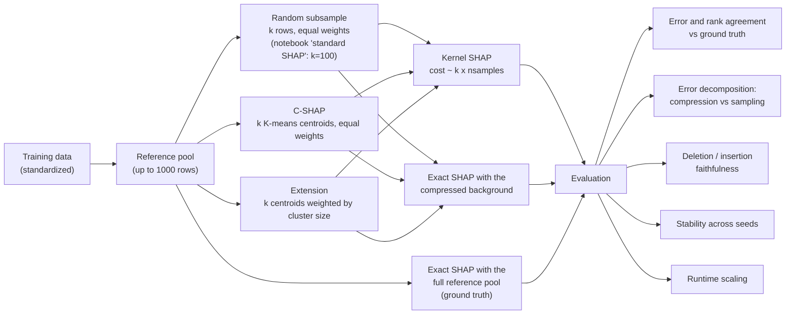

Exact interventional SHAP values are available for all three model families:
- Tree SHAP (`shap.TreeExplainer`, interventional) for the random forest (probability output) and gradient boosting (log-odds output);
- the closed form `phi_j = w_j (x_j - E[x_j])` for logistic regression (log-odds output).

Comparing exact values for a compressed background with exact values for the
full background isolates the cost of compression. Comparing Kernel SHAP with
exact values for the *same* background isolates Kernel SHAP's own Monte Carlo
error.

## Results

### 1. Replication of the original notebook

Breast Cancer, random forest (test accuracy 0.956), 20 test instances, timed on
one core while the server was shared with other jobs.

| Background | rows | seconds (20 instances) | non-zero attributions per instance | error vs exact | rank corr. vs exact | global Pearson vs exact |
|---|---|---|---|---|---|---|
| *shap default `l1_reg="num_features(10)"` (what the notebook ran)* | | | | | | |
| Standard SHAP: 100 random rows | 100 | 15.86 | 10 | 0.382 | 0.814 | 0.988 |
| C-SHAP: 20 K-means centroids | 20 | 3.18 (incl. 0.05 K-means) | 10 | 0.478 | 0.804 | 0.991 |
| Control: 20 random rows | 20 | 3.19 | 10 | 0.433 | 0.795 | 0.986 |
| *full Kernel SHAP, `l1_reg=False`* | | | | | | |
| Standard SHAP: 100 random rows | 100 | 14.16 | 30 | 0.069 | 0.973 | 1.000 |
| C-SHAP: 20 K-means centroids | 20 | 3.08 | 30 | 0.309 | 0.920 | 0.998 |
| Control: 20 random rows | 20 | 3.05 | 30 | 0.205 | 0.915 | 0.996 |

The notebook's own statistics reproduce: standard vs C-SHAP global importance
gives Pearson 0.9966 and MAD 0.00107. Two things were invisible in the original
setup:
- global importance correlates at above 0.98 with the exact values for *every* background, so it cannot tell the methods apart;
- shap ≥ 0.47 keeps only 10 of the 30 attributions per instance by default. For the 100-row background this truncation accounts for most of the error (0.382 with it, 0.069 without).

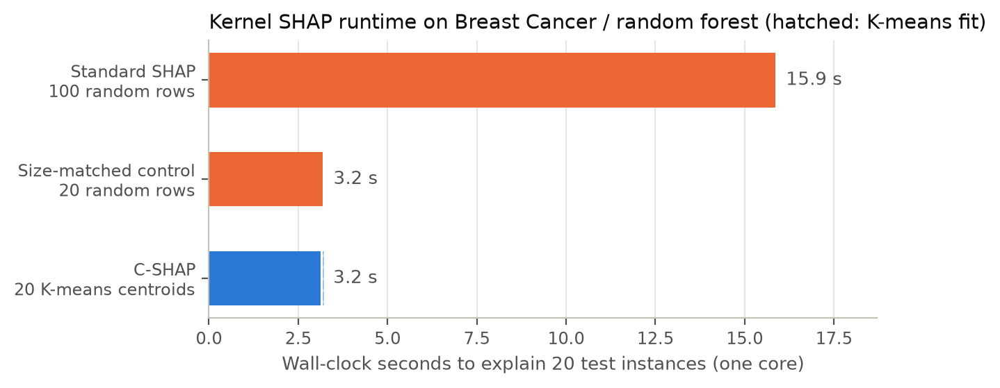
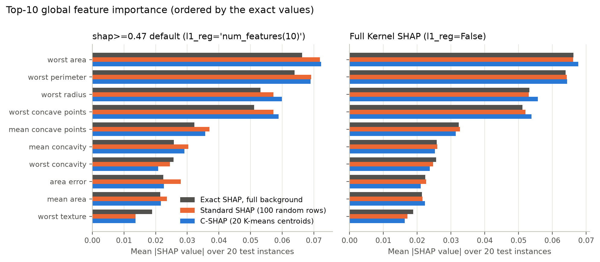
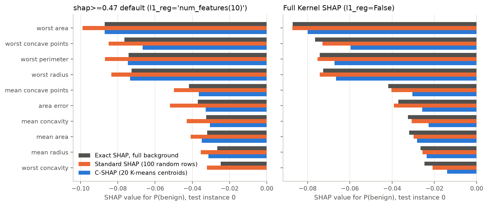

The original figures are kept in [`figures/original/`](figures/original/).

### 2. Background-compression error against exact SHAP (new)

For each dataset, model, background size k ∈ {5, 10, 20, 50, 100, 200}, method
and seed (10 seeds), exact SHAP values with the compressed background are
compared with exact SHAP values for the full reference pool (all 455 training
rows for Breast Cancer, 1,000 random training rows for MAGIC and Spambase).
Exact-vs-exact means there is no Monte Carlo noise. The comparison measures
only what compressing the background does.

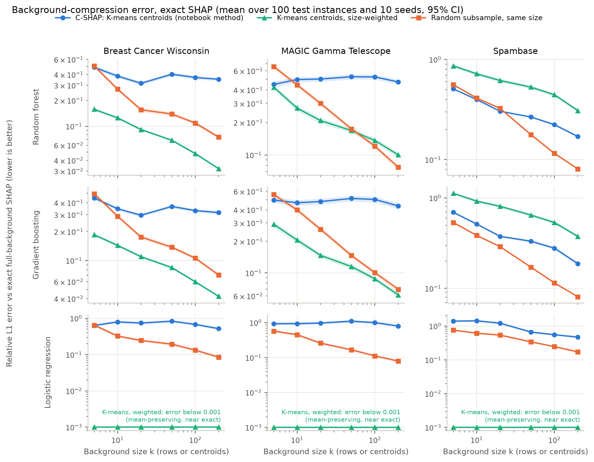

Random subsamples converge towards the reference as k grows: their error at
k = 200 is 12–23% of their error at k = 5. Equal-weight centroids do not
converge on Breast Cancer and MAGIC (70–105%). The reason is visible in the
background mean:

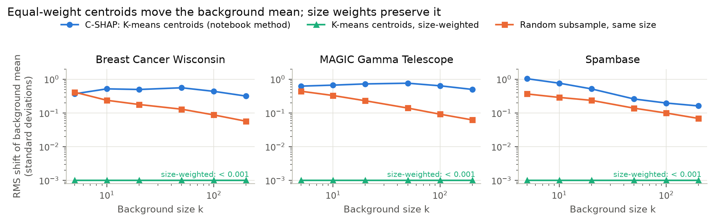

K-means places centroids on small, outlying clusters as well as on dense ones.
With equal weights, those outlying centroids count as much as the dense ones,
so the background distribution, and with it every attribution, shifts. Size
weights restore the mean (to within 0.001 standard deviations). That is why
the weighted variant is exact for logistic regression and much better on the
two dense datasets. Spambase is different: 77% of its values are zero, 50 of
its 57 features are zero for most e-mails, and the median feature skewness is
9.7, against 1.4 for Breast Cancer and 0.6 for MAGIC. A centroid averages rare
large values into small non-zero values that no real e-mail has. A likely
explanation for the poor tree-model results there is that the trees react to
these off-manifold points. On Spambase, weighting makes things worse and a
plain random subsample is the safest choice.

Ranking agreement (per-instance Spearman correlation of |SHAP| with the exact
values) shows the same pattern:

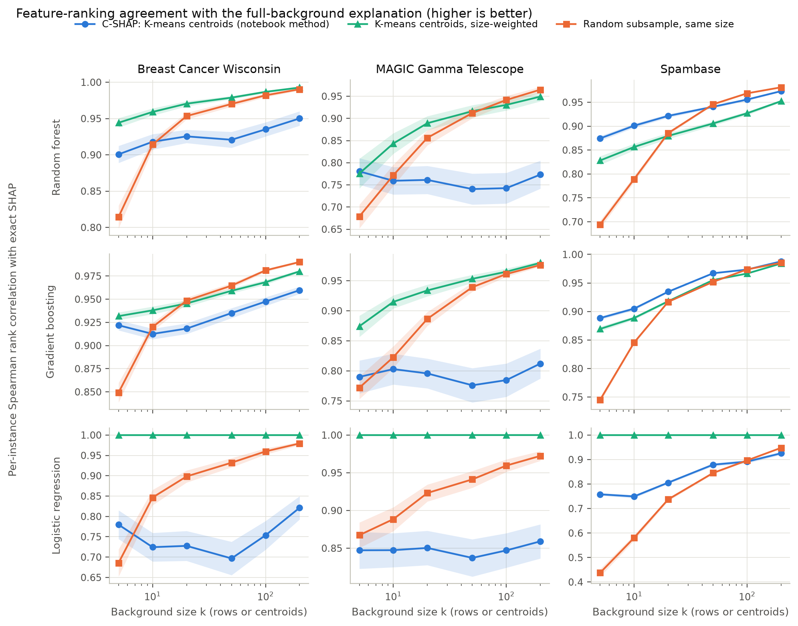

**Significance.** Each comparison is a two-sided Wilcoxon signed-rank test on
the 100 per-instance errors (averaged over the 10 seeds), with Holm correction
across all 162 tests. Only 2 of 162 differences were not significant
(`results/sweep/tests.csv`, which also has bootstrap CIs and rank-biserial
effect sizes):

| comparison (54 settings each) | first method better | second method better | not significant |
|---|---|---|---|
| C-SHAP vs random | 8 | 46 | 0 |
| weighted centroids vs random | 39 | 14 | 1 |
| weighted vs C-SHAP | 41 | 12 | 1 |

### 3. End-to-end Kernel SHAP: runtime, accuracy and where the error comes from (new)

Every dataset × model × k ∈ {10, 20, 50, 100} × method was run with 3 seeds.
Kernel SHAP explained 50 test instances with `nsamples = 2M + 2048` (shap's
`"auto"`) and `l1_reg=False`. Each Kernel SHAP result is split into the
background error (exact SHAP with background B vs the exact full-background
values) and the sampling error (Kernel SHAP with B vs exact SHAP with B):

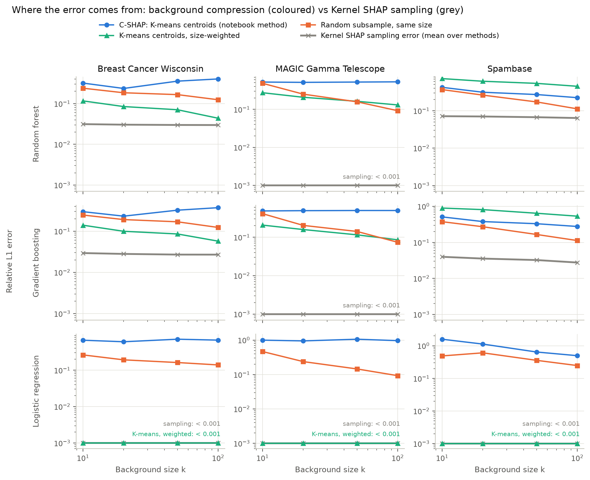

The sampling error is small everywhere and essentially zero in two cases:
- logistic regression, an additive model for which the Kernel SHAP regression is exact;
- MAGIC, where 10 features mean the 2,068-sample budget enumerates all 1,024 coalitions.

It is about 0.03 on Breast Cancer (30 features) and 0.02–0.08 on Spambase (57
features). In every panel the background, not the sampler, sets the error.

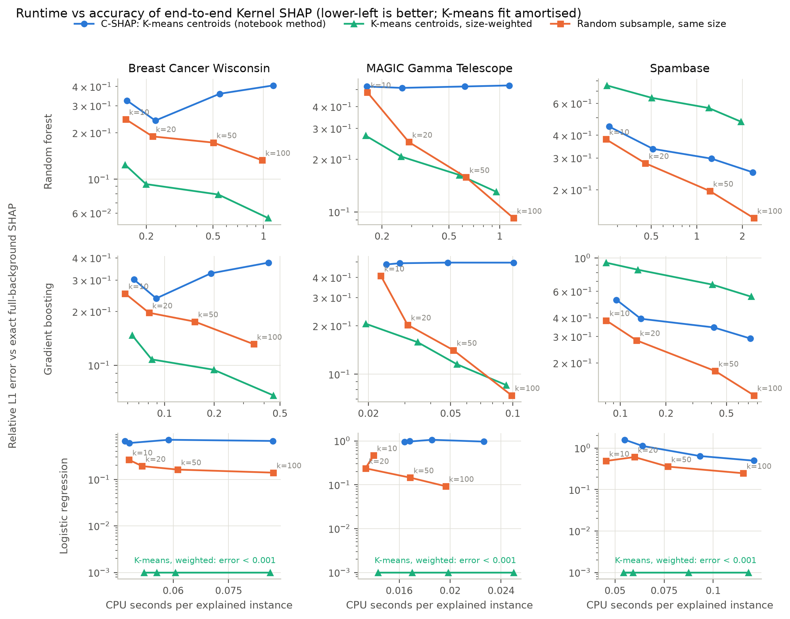

At the same k, the three backgrounds cost about the same per instance. The
fastest and slowest differ by a median of 11% (at most 30%), and each method
is fastest in some settings, which is within the noise of a shared server.
Seconds below are CPU time per instance. The notebook's comparison,
generalised to all nine settings:

| dataset / model | C-SHAP k=20: error | s/inst | random k=20: error | weighted k=20: error | random k=100 ("standard"): error | s/inst | speed-up of C-SHAP |
|---|---|---|---|---|---|---|---|
| Breast Cancer / RF | 0.240 | 0.225 | 0.189 | **0.093** | 0.133 | 0.980 | 4.4× |
| Breast Cancer / GBM | 0.237 | 0.088 | 0.197 | **0.108** | 0.131 | 0.347 | 3.9× |
| Breast Cancer / LogReg | 0.601 | 0.046 | 0.192 | **0.000** | 0.139 | 0.087 | 1.9× |
| MAGIC / RF | 0.512 | 0.261 | 0.251 | 0.207 | **0.092** | 1.209 | 4.6× |
| MAGIC / GBM | 0.490 | 0.026 | 0.203 | 0.158 | **0.074** | 0.099 | 3.8× |
| MAGIC / LogReg | 0.947 | 0.014 | 0.237 | **0.000** | 0.093 | 0.020 | 1.4× |
| Spambase / RF | 0.337 | 0.511 | 0.280 | 0.644 | **0.140** | 2.387 | 4.7× |
| Spambase / GBM | 0.394 | 0.134 | 0.283 | 0.837 | **0.122** | 0.760 | 5.7× |
| Spambase / LogReg | 1.126 | 0.063 | 0.607 | **0.000** | 0.247 | 0.115 | 1.8× |

*Total error of Kernel SHAP vs exact full-background SHAP, mean over 50
instances × 3 seeds (`results/kernel/summary.csv`).*

Paired Wilcoxon tests on total error (36 settings per comparison, Holm-adjusted,
`results/kernel/tests.csv`):

| comparison | first better | second better | not significant |
|---|---|---|---|
| C-SHAP vs random, same k | 0 | 36 | 0 |
| weighted centroids vs random, same k | 25 | 10 | 1 |
| weighted vs C-SHAP | 28 | 8 | 0 |

This experiment uses only 3 seeds and the first 50 test instances. Where two
backgrounds are close, it can rank them differently from the 10-seed sweep
above: Spambase / random forest at k ≤ 20 favours C-SHAP in the sweep and
random rows here. The sweep is the more precise estimate of background error.

### 4. Faithfulness: deletion and insertion curves (new)

Deletion removes features in order of attributed support for the predicted
class and tracks the predicted-class score; insertion adds them in the same
order. "Removing" a feature replaces it with values from 32 random rows of the
reference pool, the same rows for every method. The score is insertion AUC
minus deletion AUC, relative to the exact full-background attributions (= 1).
The attributions are the seed-0 Kernel SHAP runs from §3 (50 instances).

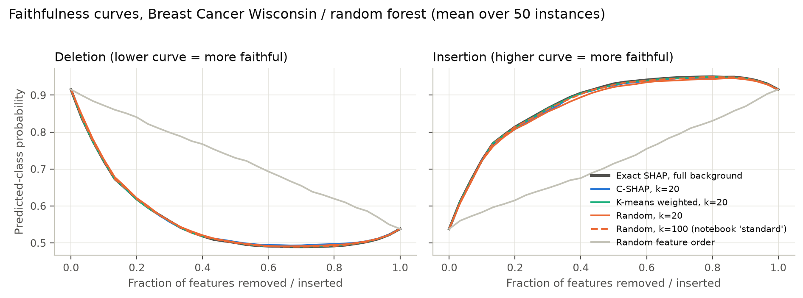
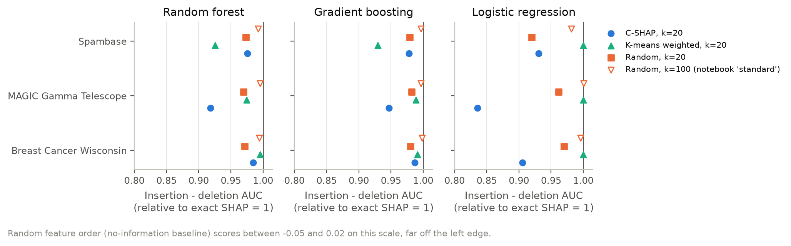

- Every background produces a useful feature ranking: all are far above a random feature order, which scores −0.05 to 0.02 on this scale.
- C-SHAP reaches 84–99% of the exact explanation's score (median 95%), 20 random rows 92–98% (median 97%), weighted centroids 93–100% (median 99%) and 100 random rows 98–100%.
- C-SHAP is significantly less faithful than the exact attributions in all 18 tests (9 settings × deletion and insertion).
- Against 20 random rows, 13 of 18 differences are not significant (C-SHAP better in 2, random better in 3). Weighted centroids beat 20 random rows in 9, lose in 4, and 5 are not significant (`results/faithfulness/tests.csv`, Holm-adjusted).

Faithfulness differences are much smaller than the attribution errors in §2–3:
a shifted explanation can still put the important features first. Imputing
from the reference pool also favours the exact attributions, which are defined
against the same distribution.

### 5. Stability across seeds (new)

Each seed changes the K-means initialisation, or which rows are sampled. With
exact SHAP (background effect only), the centroid backgrounds give almost the
same explanation for every seed. Random subsamples of 5–20 rows do not:

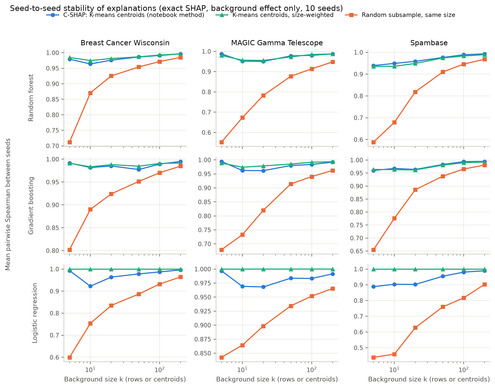

End-to-end Kernel SHAP adds sampling noise to the background effect. At
k = 20, the mean pairwise per-instance Spearman correlation between the three
seeds was 0.82–0.99 for C-SHAP, 0.75–1.00 for weighted centroids and 0.71–0.90
for random subsamples. The exception is Spambase / gradient boosting, where
weighted centroids were the least stable (0.75):

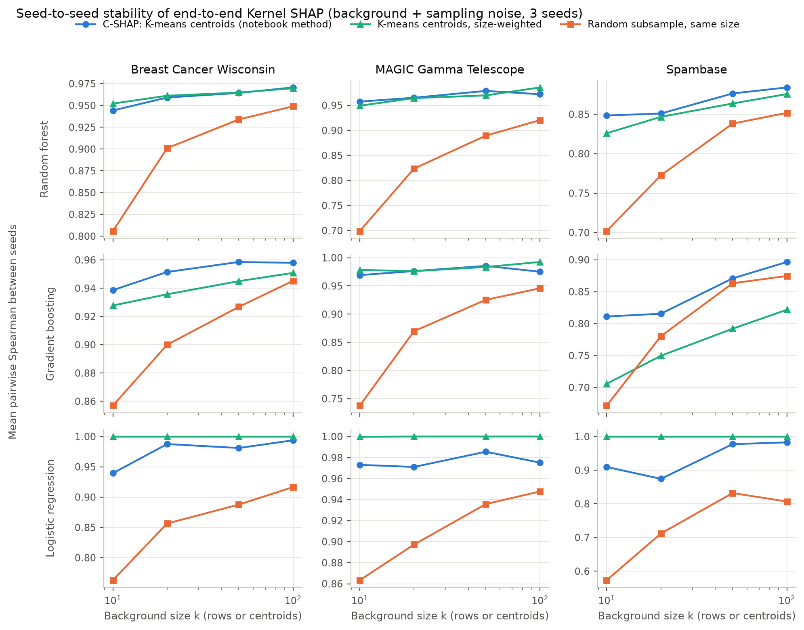

Stability is not accuracy. Centroid backgrounds are the most repeatable
choice at small k, but C-SHAP repeats the same shifted explanation (§2).

### 6. Runtime scaling (new)

Sequential single-core timings, random forest, 3 instances per point:

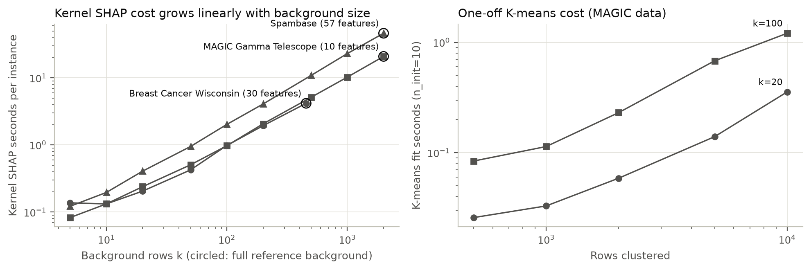

| dataset (features) | k = 20 | k = 100 | full background | full / k=20 |
|---|---|---|---|---|
| Breast Cancer (30) | 0.21 s | 0.98 s | 4.17 s (455 rows) | 20× |
| MAGIC (10) | 0.24 s | 0.97 s | 20.84 s (2,000 rows) | 87× |
| Spambase (57) | 0.41 s | 2.02 s | 46.11 s (2,000 rows) | 113× |

K-means itself is cheap by comparison: 0.36 s for k = 20 and 1.2 s for k = 100
on 10,000 MAGIC rows (`n_init=10`). It is paid once per background, not per
explanation.

## Quickstart

```bash
git clone https://github.com/golshidr/c-shap-vs-shap-interpretability-analysis.git
cd c-shap-vs-shap-interpretability-analysis
python3.11 -m venv .venv && source .venv/bin/activate
pip install -r requirements-dev.txt && pip install -e . --no-deps
pytest                                   # 27 tests, about 25 s
```

Use C-SHAP on your own model from Python:

```python
from cshap import CShapExplainer

f = lambda X: model.predict_proba(X)[:, 1]          # any scalar-output function
explainer = CShapExplainer(f, n_clusters=20, weighted=False).fit(X_train)
result = explainer.explain(X_new)                   # Kernel SHAP, l1_reg=False, seeded
result.values, result.base_value, result.seconds
```

Or from the command line, with a joblib-saved scikit-learn model:

```bash
cshap explain --model model.joblib --background train.csv --data new_rows.csv \
    --k 20 --drop-columns target --output attributions.csv
cshap compare --model model.joblib --background train.csv --data new_rows.csv \
    --k 20 --reference-size 100 --drop-columns target   # C-SHAP vs random backgrounds
```

## Reproducing the results

```bash
make install            # pinned dependencies + package
make data               # downloads MAGIC and Spambase from OpenML into data/raw/
make reproduce          # all experiments, figures/ and reports/index.html
```

`make reproduce` runs these steps (each can be run on its own):

```bash
cshap run replicate    --config configs/default.yaml   # ~1 min, single core
cshap run runtime      --config configs/default.yaml   # ~7 min, single core
cshap run sweep        --config configs/default.yaml --n-jobs 20
cshap run kernel       --config configs/default.yaml --n-jobs 20
cshap run faithfulness --config configs/default.yaml --n-jobs 9
cshap run stability    --config configs/default.yaml
cshap figures && cshap report
```

The results in this README come from one run on a shared 64-core Linux server
(Intel Xeon Platinum 8356H, Python 3.11, versions in `requirements.txt`).
Wall time:
- replicate: 44 s;
- runtime: 7 min;
- sweep: 25 min on 20 workers;
- kernel: 9 min on 20 workers;
- faithfulness and stability: under 30 s.

For a quick end-to-end check on a laptop (Breast Cancer only, about a minute):
`make smoke`. CI runs the same smoke configuration.

All randomness is seeded: the data split, models, K-means, random subsamples
and Kernel SHAP's coalition sampling (per instance, so results do not depend
on `n_jobs`). Runtimes depend on the machine and its load.

## Project structure

```
├── src/cshap/                  importable package
│   ├── backgrounds.py          random / K-means (C-SHAP) / weighted-centroid backgrounds
│   ├── explain.py              seeded parallel Kernel SHAP, CShapExplainer
│   ├── reference.py            exact interventional SHAP (Tree SHAP, linear closed form)
│   ├── metrics.py              agreement and stability metrics
│   ├── faithfulness.py         deletion / insertion curves
│   ├── stats.py                Wilcoxon, bootstrap CI, Holm correction
│   ├── data.py, models.py      datasets and model families
│   ├── plotting.py, report.py  figures and HTML report
│   ├── experiments/            replicate, sweep, kernel, faithfulness, stability, runtime
│   └── cli.py                  `cshap` command
├── configs/                    default.yaml (paper-scale), smoke.yaml (CI)
├── notebooks/
│   ├── 01_original_c_shap_vs_shap.ipynb    original analysis (kept, one bug fixed)
│   └── 02_cshap_package_walkthrough.ipynb  the same analysis through the package
├── results/                    CSV outputs of every experiment (small, committed)
├── figures/                    generated figures; figures/original/ = notebook figures
├── reports/index.html          HTML report built from results/
├── scripts/download_data.py    dataset download
├── tests/                      pytest suite
└── docs/business_insights.md   insights written by the original notebook
```

## Datasets

| Dataset | Rows × features | Positive class | Source | License |
|---|---|---|---|---|
| Breast Cancer Wisconsin (Diagnostic) | 569 × 30 | benign (scikit-learn coding) | bundled with scikit-learn; [UCI 17](https://archive.ics.uci.edu/dataset/17/breast+cancer+wisconsin+diagnostic), doi:10.24432/C5DW2B | CC BY 4.0 |
| MAGIC Gamma Telescope | 19,020 × 10 | gamma (signal) | [OpenML 1120](https://www.openml.org/d/1120), mirror of [UCI 159](https://archive.ics.uci.edu/dataset/159/magic+gamma+telescope), doi:10.24432/C52C8B | CC BY 4.0 (UCI) |
| Spambase | 4,601 × 57 | spam | [OpenML 44](https://www.openml.org/d/44), mirror of [UCI 94](https://archive.ics.uci.edu/dataset/94/spambase), doi:10.24432/C53G6X | CC BY 4.0 (UCI) |

`python scripts/download_data.py` (or `make data`) caches MAGIC and Spambase as
CSV in `data/raw/`, which is git-ignored. Every dataset uses a stratified 80/20
split (seed 42) and standardization fitted on the training split, as in the
notebook.

## Implementation notes and pitfalls found

These affect anyone running similar SHAP comparisons with the pinned
`shap==0.51.0`:

1. **Kernel SHAP keeps only 10 features by default.** Since shap 0.47,
   `KernelExplainer.shap_values` defaults to `l1_reg="num_features(10)"`. On a
   30-feature dataset, 20 attributions per instance are therefore exactly zero.
   The original notebook used the default, which is why its per-instance errors
   are large (table in Results §1). `cshap` uses `l1_reg=False` unless told
   otherwise.
2. **`TreeExplainer(model, data=X)` subsamples the background to 100 rows
   without warning.** The array is wrapped in `maskers.Independent(X,
   max_samples=100)`. A "full background" reference built that way silently
   uses 100 random rows. `cshap.reference` builds the masker explicitly, and a
   regression test checks that the whole background is used.
3. **`TreeExplainer(model_output="probability")` is not exact for gradient
   boosting.** It satisfies efficiency but disagrees with brute-force Shapley
   enumeration (for example 0.113 vs 0.110 for the top feature on a toy
   problem). Gradient boosting is therefore explained in log-odds space, where
   Tree SHAP is exact. A brute-force test covers all three model families.
4. **Exact Tree SHAP for the random forest is not perfectly additive.** The
   attributions plus the base value match the predicted probability to within
   1e-4 for 99 of 100 test instances on Breast Cancer and on MAGIC, but only
   94 of 100 on Spambase. The largest gaps (0.00498–0.00505) are almost exactly
   one tree's vote out of 200, which points to threshold ties inside shap's
   tree traversal. The effect is small next to the errors reported here,
   which are of order 0.1 (`results/sweep/meta.csv`).

## Limitations

- Exact references limit the study to tree ensembles and linear models. Neural
  networks and other black boxes, where Kernel SHAP is most useful, are not
  covered.
- The "full" background is the training set capped at 1,000 rows (sweep and
  Kernel experiments) or 2,000 rows (runtime). Conclusions are relative to that
  reference distribution. All backgrounds are explanations of the
  interventional (marginal) SHAP game. Other games, such as conditional or
  observational SHAP, are not studied.
- Three datasets, all binary classification and all numeric. Categorical
  features (where centroids are even less meaningful) and regression are not
  covered.
- Runtimes were measured on a shared 64-core server under variable load from
  other users. Ratios are more reliable than absolute seconds.
- Significance tests treat test instances as the unit of replication, with
  results averaged over seeds. They show the differences are systematic for
  these models and splits; they do not generalise over datasets.
- The paper's C-SHAP may differ from the notebook's variant in ways not
  examined here.

## Next steps

- Medoid backgrounds (real rows nearest each centroid), which avoid
  off-manifold centroids such as those seen on Spambase.
- Stratified or importance-weighted random subsamples as stronger baselines.
- Black-box models (MLP, SVM) with high-budget Kernel SHAP or permutation SHAP
  as an approximate reference.
- Choosing k automatically from the background-mean shift or a held-out
  agreement score.

## Citation

If you use this code, please cite the C-SHAP paper above.

## License

Released under the [MIT License](LICENSE).
Copyright (c) 2026 Golshid Ranjbaran.
